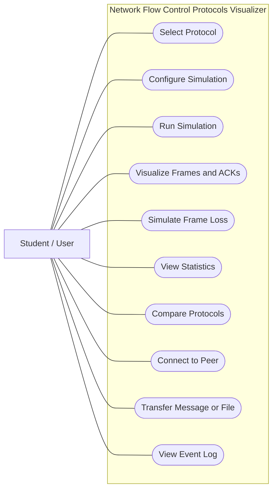
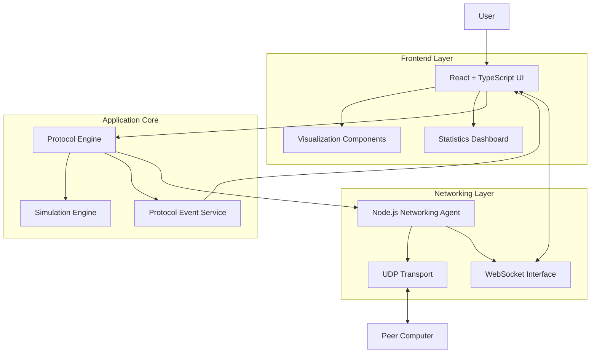
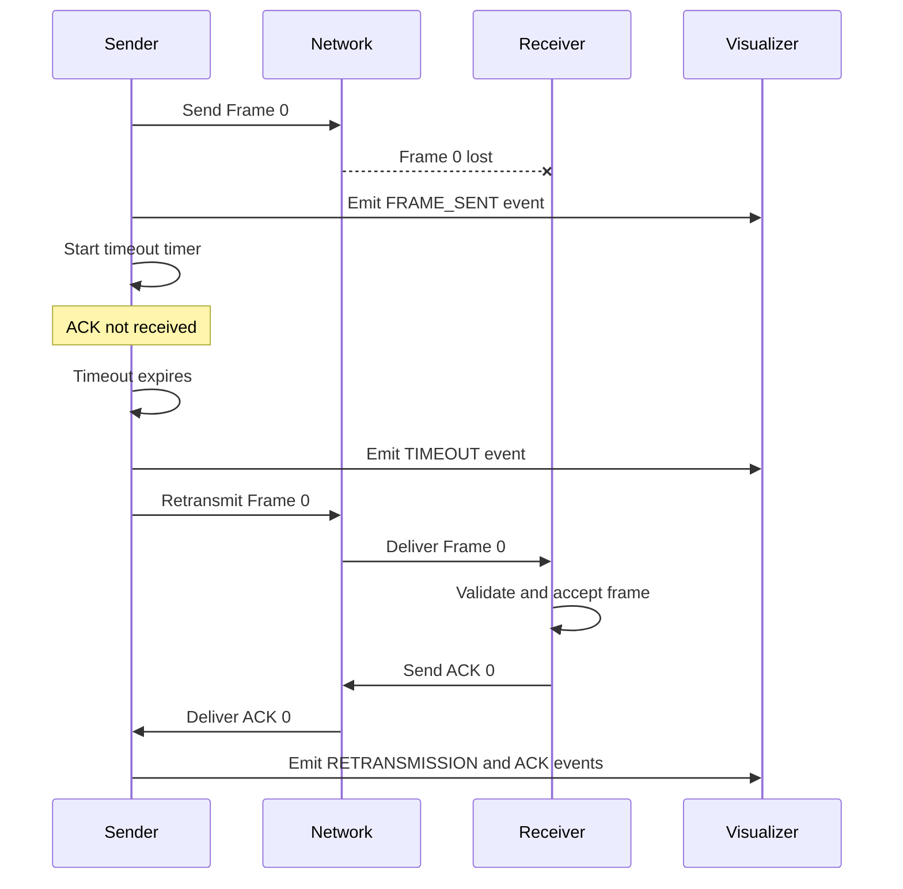
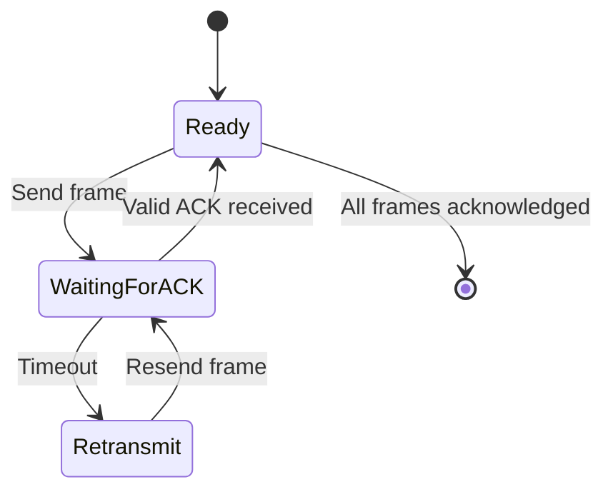
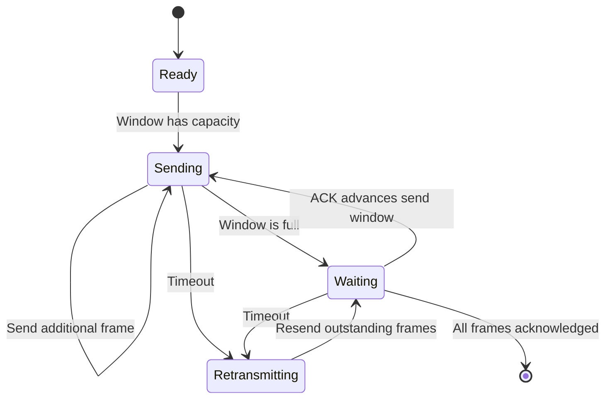
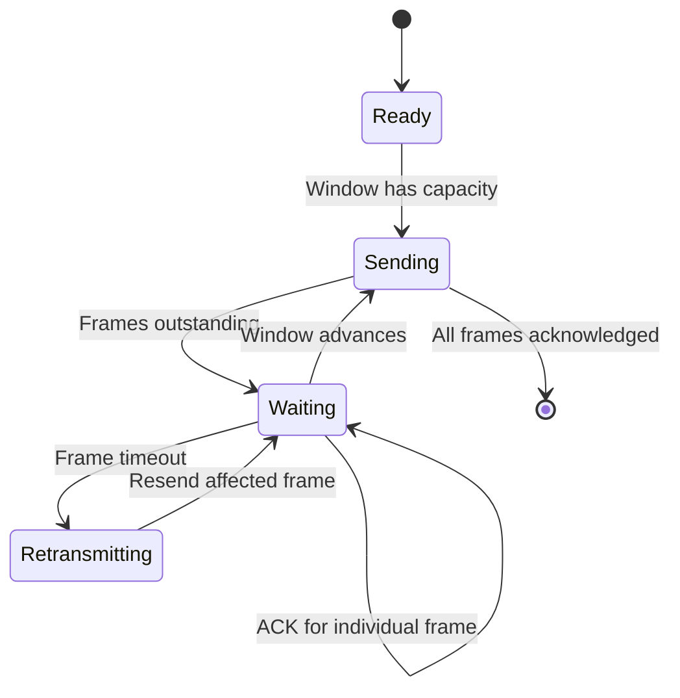
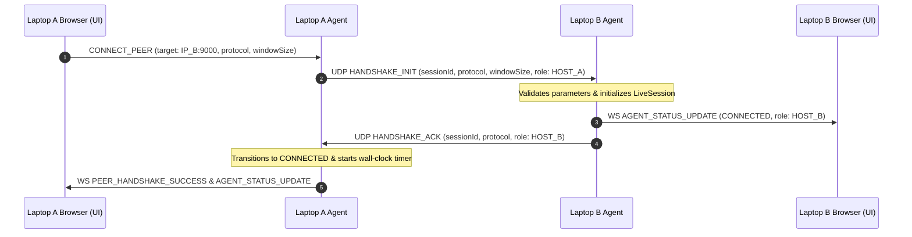
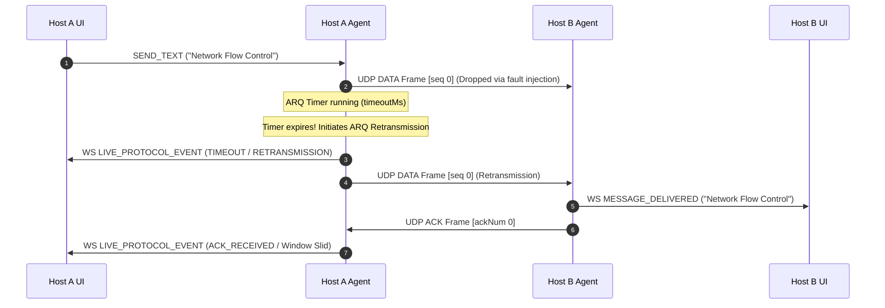

# UML Diagrams
## Network Flow Control Protocols Visualizer

**Version:** 1.0  
**Purpose:** System design and Software Engineering documentation.

---

## 1. Use-Case Diagram

This diagram represents the interactions between the user and the system.

**Explanation:** The user selects protocols, configures and executes simulations, observes protocol behavior, compares results, and optionally uses live communication.

## 2. Component Diagram

This diagram describes the major software components and their responsibilities.

**Explanation:**

- The frontend accepts user input and displays protocol events.
- The protocol engine manages sequencing, windows, acknowledgements, timeouts and retransmissions.
- The simulation engine provides controlled frame loss and delay.
- The networking agent exchanges real UDP datagrams.
- The WebSocket interface streams live events to the dashboard.

The exact implementation interfaces will be finalized during detailed design.

## 3. Sequence Diagram — Successful Frame Transmission

This diagram illustrates a simplified Stop-and-Wait ARQ exchange.

```mermaid
sequenceDiagram
    actor User
    participant S as Sender
    participant N as Network
    participant R as Receiver
    participant V as Visualizer

    User->>S: Start transmission
    S->>S: Create frame with sequence number
    S->>N: Send frame
    S->>V: Emit FRAME_SENT event
    N->>R: Deliver frame
    R->>R: Validate frame and sequence number
    R->>V: Emit FRAME_RECEIVED event
    R->>N: Send ACK
    N->>S: Deliver ACK
    S->>S: Validate ACK and update state
    S->>V: Emit ACK_RECEIVED event
    S->>S: Send next frame if available
```

**Explanation:** The sender transmits one frame and waits for its acknowledgement before proceeding. The visualizer reflects the events produced by the protocol engine.

## 4. Sequence Diagram — Frame Loss and Retransmission

**Explanation:** When a frame is lost, the sender detects the timeout and retransmits. The receiver processes the retransmitted frame and acknowledges it.

## 5. Protocol State Diagram — Stop-and-Wait ARQ

**Explanation:** Stop-and-Wait permits one outstanding data frame at a time. The sender proceeds after receiving the expected acknowledgement or retransmits after a timeout.

## 6. Protocol State Diagram — Go-Back-N ARQ

**Explanation:** Go-Back-N allows multiple outstanding frames. Following a timeout, the sender retransmits the outstanding frames beginning with the oldest unacknowledged frame.

## 7. Protocol State Diagram — Selective Repeat ARQ

**Explanation:** Selective Repeat maintains individual acknowledgement and retransmission state for frames. Valid out-of-order frames can be buffered, and only frames requiring recovery are retransmitted.

---

## 8. Design Notes

1. The diagrams describe the intended architecture and behavior, not proof of an implemented system.
2. Protocol state machines will be refined alongside the detailed design and automated tests.
3. Sliding Window is a general mechanism; Go-Back-N and Selective Repeat are specific ARQ strategies that use windowing.
4. Simulation events and live network events must be distinguishable in the implementation.
5. All final protocol behavior must be verified against the requirements in `SRS.md`.
6. Live UDP datagram communication operates across native Node.js sockets (`dgram`), streaming telemetry to the React frontend over loopback WebSocket.

---

## 9. Live UDP Networking Sequence Diagrams (Phase 6)

### 9.1 Two-Laptop UDP Handshake Sequence

### 9.2 Live Message Exchange with ARQ Retransmission

---

**End of Document**

---

**End of Document**
